# PoopTracker Kılavuzu

*[English](MANUAL.md)*

PoopTracker, FastTracker 2 tarzı bir tracker. Farkı, sample'larının video olması: her nota bir klip çalar ve şarkı
9:16 bir müzik videosu olarak çıkar. Bu kılavuz ekranı parça parça anlatır. Sadece hemen ses çıkarmak istiyorsan
[Hızlı başlangıç](#hizli-baslangic) bölümünü oku ve sağ alttaki **Keys** listesini açık tut.

Arayüz İngilizce olduğu için düğme ve alan adları burada da ekranda göründükleri gibi yazıldı.

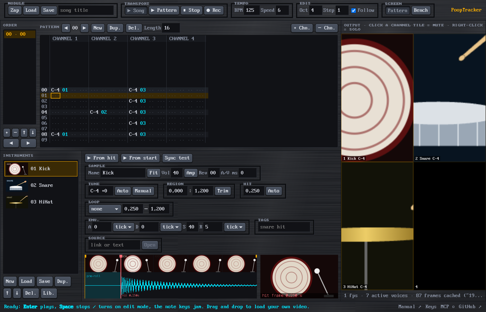

> PoopTracker bir alfa sürümü. Chrome'da geliştiriliyor ve deneniyor. Bugün kaydettiğin şarkılar yarın açılmayabilir
> ([ZEN-COURAGE](ZEN.md)).

## İçindekiler

1. [Hızlı başlangıç](#hizli-baslangic)
2. [Ekran](#ekran)
3. [Üst bar](#ust-bar)
4. [Pattern editörü](#pattern-editoru)
5. [Order listesi](#order-listesi)
6. [Enstrümanlar](#enstrumanlar)
7. [Çıktı](#cikti)
8. [Tezgâh (Bench)](#tezgah)
9. [Efektler](#efektler)
10. [Dosyalar: şarkılar, enstrüman videoları, MIDI, kayıtlar](#dosyalar)
11. [Bir yapay zekâyla birlikte çalmak (MCP)](#mcp)
12. [Klavye özeti](#klavye-ozeti)

---

<a id="hizli-baslangic"></a>
## Hızlı başlangıç

1. Chrome'da https://miratcan.github.io/pooptracker/ adresini aç. Kurulacak bir şey yok. (Kendi bilgisayarında
   çalıştırmak yalnızca [MCP](#mcp) için gerekli.)
2. Hazır bir demo ritim (Kick, Snare, HiHat) yüklü gelir. Çalmak için **Enter**, durdurmak için **Space**. Sen
   çalıştıkça parçan tarayıcıda saklanır: PoopTracker'ı bir dahaki açışında demo yerine o gelir.
3. Kısa bir videoyu (birkaç saniyelik, içinde net bir ses olan) sayfanın herhangi bir yerine bırak. Yeni bir
   enstrüman olur.
4. Pattern'e tıkla, edit modunu açmak için **Space**'e bas (pattern kırmızı çerçeve alır) ve klavyeden nota çal:
   `Z S X D C V…` bir oktav, `Q 2 W 3 E R…` onun bir üstü. Her tuş seçili enstrümanla bir nota yazar.
5. Dinlemek için **Enter**. Sonucu video dosyası olarak almak istediğinde **Rec**.

---

<a id="ekran"></a>
## Ekran

PoopTracker'ın iki ekranı var, **Pattern** ve **Bench**, ikisi aynı pencereyi paylaşır. Bu, Pattern ekranı:

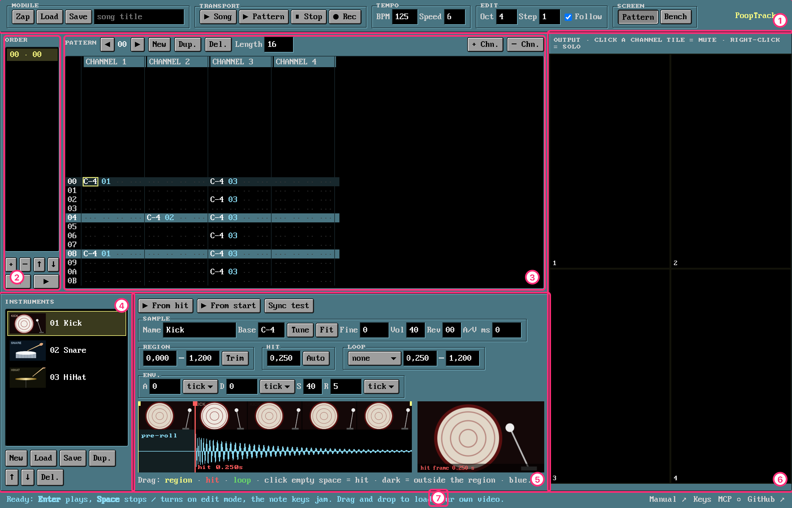

| # | Bölüm | Ne işe yarar |
|---|-------|--------------|
| 1 | [Üst bar](#ust-bar) | Şarkı dosyaları, çalma, tempo, edit ayarları ve ekran değiştirme |
| 2 | [Order](#order-listesi) | Şarkıyı oluşturmak için pattern'lerin hangi sırayla çalacağı |
| 3 | [Pattern editörü](#pattern-editoru) | Notaları yazdığın ızgara |
| 4 | [Enstrümanlar](#enstrumanlar) | Enstrümanların (videolar) |
| 5 | [Enstrüman ayarları](#enstruman-ayarlari) | Seçili enstrümanın nasıl çaldığı: bölge, vuruş, döngü, zarf… |
| 6 | [Çıktı](#cikti) | Müzik videosu, her kanal için bir kare |
| 7 | Durum çubuğu | Mesajlar, hatalar, **Manual** ve **Keys** linkleri, MCP ışığı |

Bench ekranında order listesi ve pattern editörünün yerine [tezgâh](#tezgah) gelir. Enstrümanlar ve çıktı görünür
kalır.

PoopTracker hiçbir zaman "emin misin?" diye sormaz. Şarkıyı değiştiren ya da tezgâhtan bir videoyu atan her şey **⌘/Ctrl+Z** ile geri alınır,
**⌘/Ctrl+Shift+Z** ile yeniden yapılır ([ZEN-NO-CONFIRMATION](ZEN.md)).

---

<a id="ust-bar"></a>
## Üst bar

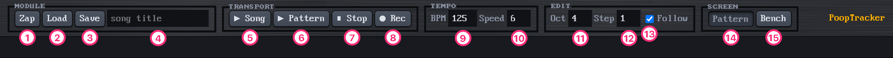

| # | Kontrol | Ne yapar |
|---|---------|----------|
| 1 | **Zap** | FT2'deki gibi neyin boşaltılacağını sorar: **All** (pattern'ler, order, şarkı ayarları ve enstrümanlar), **Tracks** (pattern'ler, order ve şarkı ayarları; enstrümanlar kalır) ya da **Instruments** (notalar kalır, enstrüman numaraları silinir). Esc hiçbir şeyi boşaltmaz; ⌘/Ctrl+Z boşaltılanı geri getirir. |
| 2 | **Load** | Bir `.poop` şarkısı açar ya da bir MIDI dosyası (`.mid`) içe aktarır. Kısayol: ⌘/Ctrl+O. Dosyayı sayfaya bırakmak da olur. |
| 3 | **Save** | Şarkıyı videolarıyla birlikte tek bir `.poop` dosyası olarak kaydeder. Kısayol: ⌘/Ctrl+S. |
| 4 | Başlık | Şarkının adı. Kaydederken ve video kaydı alırken dosya adı olarak da kullanılır. |
| 5 | **▶ Song** | Şarkıyı baştan çalar (**Enter**). |
| 6 | **▶ Pattern** | Düzenlediğin pattern'i döngüde çalar (**⌘/Ctrl+Enter**). |
| 7 | **■ Stop** | Çalmayı durdurur (**Space**). |
| 8 | **● Rec** | Şarkıyı baştan video olarak kaydeder. Kayıt sürerken **▶ Song** ile **● Rec** basılı kalır, yalnızca **■ Stop** çalışır. Bkz. [Video kaydı](#video-kaydi). |
| 9 | **BPM** | Tempo, 32–255. Bir tick 2,5 / BPM saniye sürer. |
| 10 | **Speed** | Satır başına tick sayısı, 1–31. Düşük speed satırları daha hızlı çalar. |
| 11 | **Oct** | Alt sıradaki nota tuşlarının oktavı (F1–F8 de değiştirir). |
| 12 | **Step** | Bir nota yazdıktan sonra imlecin kaç satır aşağı ineceği (0 = inmez). `` ` `` tuşu değiştirir. |
| 13 | **Follow** | Çalarken pattern ve order listesi müzikle birlikte kayar (⌘/Ctrl+F). |
| 14 | **Pattern** | Pattern ekranı. |
| 15 | **Bench** | [Tezgâh](#tezgah). ⌘/Ctrl+B iki ekran arasında geçiş yapar. |

Üst bardaki bir alandan fareye dokunmadan çıkmak için **Esc**'e bas. Tuşlar o zaman pattern'e döner.

---

<a id="pattern-editoru"></a>
## Pattern editörü

Pattern bir ızgaradır. Satırlar zamandır ve aşağı doğru akar. Sütunlar kanaldır ve bir kanal aynı anda bir nota
çalar. Şarkı, pattern'leri [order listesindeki](#order-listesi) sırayla çalar.

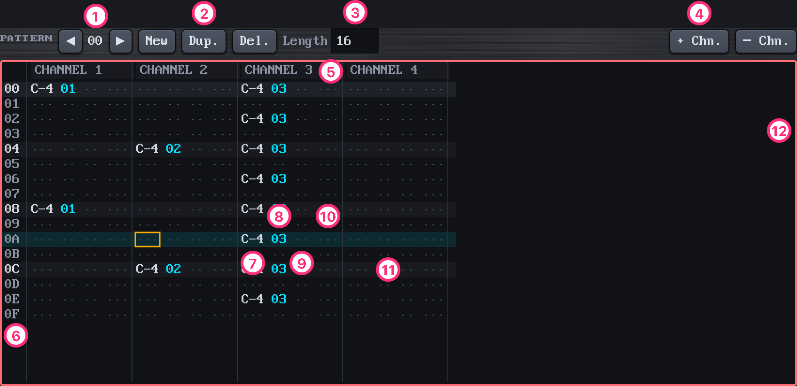

| # | Parça | Ne olduğu |
|---|-------|-----------|
| 1 | Pattern numarası | Düzenlediğin pattern. ◀ ▶ pattern'ler arasında gezer. |
| 2 | **New / Dup. / Del.** | New: aynı uzunlukta yeni boş bir pattern. Dup.: bunun bir kopyası. Del.: order kullanmıyorsa siler. |
| 3 | **Length** | Bu pattern'deki satır sayısı, 1–256. |
| 4 | **+ Chn. / − Chn.** | Sona bir kanal ekler (en çok 10) / son kanalı siler (sadece içinde çalan bir şey yoksa: tek başına `===` sayılmaz). |
| 5 | Kanal başlığı | Tıklayınca kanal susar (mute). Sağ tıklayınca sadece o kanal çalar (solo). Bir daha sağ tıklayınca hepsi geri gelir. |
| 6 | Satır numarası | Hex olarak (16 satırlık bir pattern'de `00`–`0F`). |
| 7 | **Nota** | `C-4`, `C#4`… ya da `===` (key-off: nota bırakılır). `...` boş demek. |
| 8 | **Enstrüman** | Notayı hangi enstrümanın çalacağı, hex (`01`, `02`…). |
| 9 | **Ses** | Hex `00`–`40` (`40` tam ses). Hem sesin yüksekliğini hem karenin parlaklığını değiştirir. Boşsa tam ses. |
| 10 | **Efekt** | Bir harf ve iki hex rakam, örneğin `S40`. Pembe efektler sadece videoyu etkiler. Bkz. [Efektler](#efektler). |
| 11 | Vuruş satırı | Her vuruş (burada her 4. satır) daha açık renklidir, sayması kolay olsun diye. Turuncu satır o an duyulan satır. |
| 12 | Kırmızı çerçeve | **Edit modu açık.** |

### Edit modu

**Space** (dururken) edit modunu açıp kapatır. PoopTracker kapalı başlar.

- **Kapalı:** nota tuşları seçili enstrümanı sadece *çalar*, böylece şarkıyı değiştirmeden ses deneyebilirsin.
- **Açık** (kırmızı çerçeve): nota tuşları pattern'e *yazar*. Enstrüman, ses ve efekt sütunlarına hex rakam yazarsın.

Kesme, kopyalama ve yapıştırma iki modda da çalışır.

### Nota yazmak

Klavye, FastTracker 2'deki gibi piyano düzenindedir. Tuşlar fiziksel tuşlardır, yani düzen klavye dilinden
bağımsız olarak aynıdır (Türkçe Q klavyede de):

```
 alt sıra  (oktav = Oct)          üst sıra  (oktav = Oct + 1)
  S D   G H J                      2 3   5 6 7   9 0
 Z X C V B N M                    Q W E R T Y U I O P
 C D E F G A B                    C D E F G A B C D E
```

- **F1–F8** oktavı seçer. **1** ya da **CapsLock** bir key-off (`===`) yazar.
- **Shift+↑ / ↓** enstrümanı seçer, listeye tıklamana gerek kalmaz.
- Klavyeden çalınan bir nota, tuşu bıraktığında bırakılır (zarfın R'si).
- **Perde hızdır.** Enstrümanın taban notasının on iki yarım ses üstünde video iki kat hızlı oynar. On iki yarım ses
  altında yarı hızda oynar. Vibrato görüntüyü de titretir.

### Gezinmek

| Tuşlar | Hareket |
|--------|---------|
| ↑ ↓ ← → | Bir satır / bir sütun |
| PgUp / PgDn, Home / End | 16 satır / en üst ya da en alt |
| F9 F10 F11 F12 | Pattern'in 0, ¼, ½, ¾ satırı |
| Tab / Shift+Tab | Sonraki / önceki kanal |
| Alt+Q W E R T Y U I | Kanal 1–8'e atla |
| Shift+← / → | Önceki / sonraki order pozisyonu |
| ⌘/Ctrl+← / → | Order pozisyonundaki pattern numarasını değiştir |

### Silmek ve araya eklemek

| Tuşlar | Etkisi |
|--------|--------|
| Del / Backspace | İmlecin altındaki alanı siler |
| Shift+Del | Bütün hücreyi siler |
| ⌘/Ctrl+Del | Ses ve efekti siler |
| Alt+Del | Efekti siler |
| Ins / Alt+Backspace | Bu kanala boş bir satır ekler (alttaki satırlar aşağı kayar) |
| Shift+Ins / Shift+Alt+Backspace | Bütün kanallara bir satır ekler |
| Shift+Backspace | Satırı siler, alttaki satırları yukarı çeker |

Mac'te Backspace, Del gibi alanı siler. FastTracker 2'de üstteki notayı silerdi, bu da herkesi şaşırttı.

### Bloklar

Bir blok seçmek için fareyle sürükle ya da **Alt**'a basılı tutup ok tuşlarını kullan (Shift+PgUp/PgDn/Home/End da
olur).

| Tuşlar | Etkisi |
|--------|--------|
| ⌘/Ctrl+C / X / V, ya da Alt+F4 / F3 / F5 | Bloğu kopyala / kes / yapıştır (yapıştırma imlecin olduğu yere) |
| Shift+F3 / F4 / F5 | Bütün kanalı kes / kopyala / yapıştır |
| ⌘/Ctrl+F3 / F4 / F5 | Bütün pattern'i kes / kopyala / yapıştır |
| Del | Seçimi sil |
| Esc | Seçimi bırak |

### Mute ve solo

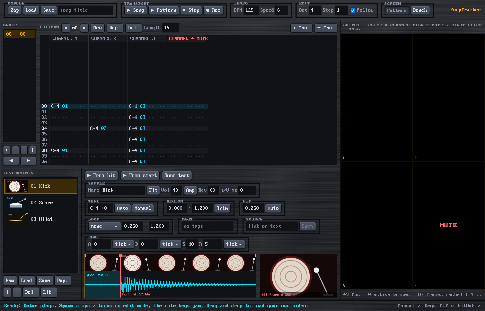

- Bir kanalı **susturmak** için başlığına ya da çıktıdaki karesine tıkla. Bir daha tıklayınca açılır.
- Bir başlığa ya da kareye sağ tıklayınca sadece o kanal çalar (**solo**). Bir daha sağ tıklayınca bütün kanallar
  geri gelir.
- **Shift+M** imlecin altındaki kanalı susturur. **⌘/Ctrl+Shift+M** susturmaları tersine çevirir. **Shift+U** hepsini
  açar.

---

<a id="order-listesi"></a>
## Order listesi

Şarkı bir pozisyon listesidir ve her pozisyon bir pattern çalar. Aynı pattern birçok kez geçebilir.

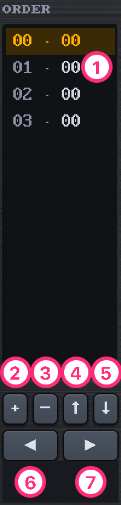

| # | Kontrol | Ne yapar |
|---|---------|----------|
| 1 | Bir pozisyon | `pozisyon · pattern`. Seçmek için tıkla. Follow açıksa liste çalarken şarkıyı takip eder. |
| 2 | **+** | Düzenlediğin pattern'i seçili pozisyonun altına ekler (⌘/Ctrl+F10) |
| 3 | **−** | Seçili pozisyonu siler (⌘/Ctrl+F9) |
| 4 | **↑** | Pozisyonu yukarı taşır |
| 5 | **↓** | Aşağı taşır |
| 6 | **◀** | Bu pozisyondaki pattern numarasını azaltır (⌘/Ctrl+←) |
| 7 | **▶** | Artırır (⌘/Ctrl+→) |

**Enter** şarkıyı 00 pozisyonundan çalar. **Shift+Enter** düzenlediğin pattern'den çalar. Şarkının daha önceki
kısımlarında ayarlanan tempo, enstrüman ve ses değerleri geçerli kalır.

---

<a id="enstrumanlar"></a>
## Enstrümanlar

Bir enstrüman bir videodur. Ayarları (sesin nerede vurduğu, döngüsü, zarfı…) enstrümana aittir ve videonun kendi
metadata'sına da kaydedilebilir ([ZEN-ONE-VIDEO-ONE-INSTRUMENT](ZEN.md)).

Bir enstrüman en fazla **8 saniye** olabilir. Daha uzun bir videonun bir parçasını kullanmak için onu
[tezgâhta](#tezgah) kes.

### Enstrüman eklemek

- Bir videoyu sayfaya bırak (Pattern ekranındayken): yeni bir enstrüman olur. Listedeki bir enstrümanın üstüne
  bırakırsan o enstrümanın videosu olur.
- Ya da enstrüman listesinin altındaki **New** ile boş bir enstrüman ekle, sonra **Load** ile ona bir video yükle.
- PoopTracker **vuruşu** (sesin patladığı anı) kendisi bulur. Kontrol et: nota, satırına tam vuruş anında oturur.
- PoopTracker'dan **Save** ile kaydedilmiş bir video, bütün ayarlarıyla geri gelir.

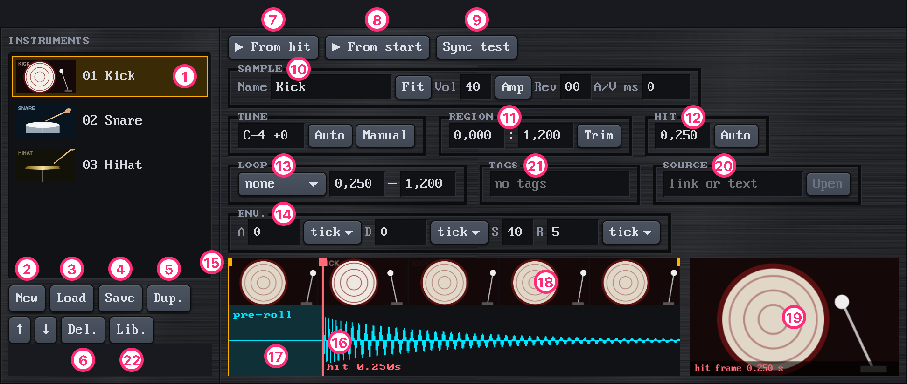

| # | Kontrol | Ne yapar |
|---|---------|----------|
| 1 | Enstrüman listesi | Seçmek için bir enstrümana tıkla (ya da Shift+↑↓). Nota tuşları seçili olanı çalar. Buradaki bir enstrümanın üstüne video bırakırsan videosu değişir. |
| 2 | **New** | Listenin sonuna, video yüklenecek boş bir enstrüman ekler |
| 3 | **Load** | **Seçili** enstrümana bir video verir, sesini korur (ad, taban nota, ince akort, ses, reverb, zarf, döngü modu); bölge ve vuruş yeni videoda yeniden bulunur. **Save** ile kaydedilmiş bir video ise kendi ayarlarının hepsini getirir. Hiç enstrüman yoksa Load yeni bir tane yapar. |
| 4 | **Save** | Videoyu, bu enstrümanın ayarları metadata'sında olacak şekilde kaydeder. Yeniden encode edilmez. Sadece MP4/MOV. |
| 5 | **Dup.** | Aynı videodan, aynı ayarlarla yeni bir enstrüman. Aynı klipten başka bir bölge almak için kullan. |
| 6 | **↑ ↓ Del.** | Enstrümanı listede yukarı ya da aşağı taşır / siler (sadece hiçbir pattern kullanmıyorsa) |
| 7 | **▶ From hit** | Enstrümanı vuruş noktasından çalar |
| 8 | **▶ From start** | Bölgesinin başından çalar |
| 9 | **Sync test** | Vuruş anında tam bir klik sesi çalar. Video senkronsa, görüntüdeki vuruş klikle denk gelir. |
| 10 | Sample | Bkz. [aşağısı](#enstruman-ayarlari) |
| 11 | Region | |
| 12 | Hit | |
| 13 | Loop | |
| 14 | Env. | |
| 15 | Bölge tutamakları | İki uçtaki turuncu işaretler. Enstrümanın videonun hangi kısmını kullandığını değiştirmek için sürükle. |
| 16 | Vuruş çizgisi | Kırmızı çizgi. Vuruşu taşımak için sürükle ya da boş bir yere tıkla. |
| 17 | Pre-roll | Vuruştan önceki mavi kısım. Notanın satırından *önce* çalar, böylece vuruş satıra denk gelir. |
| 18 | Film şeridi ve dalga formu | Bölgenin kareleri ve sesi. Koyu kısımlar bölgenin dışında kalır. |
| 19 | Vuruş karesi | Vuruş anındaki kare. Tıklayınca **odak** belirlenir: bir kare videoyu kırparken görünür tuttuğu nokta. Alt+tıklama odağı ortaya döndürür. |

<a id="enstruman-ayarlari"></a>
### Enstrüman ayarları

Seviyeler pattern'deki gibi hex'tir (`00`–`40`). Süreler ondalık saniyedir.

**Sample**
- **Name:** en fazla 16 karakter. Karenin üstünde görünür.
- **Tune** (ayrı kutu): taban nota ve ince akort, örneğin `C-4 +0`. Taban notada klip kendi hızında oynar; klibin kendi
  perdesi Base artı Fine'dır (FT2'deki gibi yarım tonun 1/128'i, −128 ile 127 arası). Bunlar gösterilir, yazılmaz.
  **Auto** klibin vuruştan sonraki perdesini bulup ikisini ayarlar; böylece yazdığın notalar yazdığın gibi duyulur.
  Klibin kendisi değişmez, içindeki bend de kalır: enstrümanın tek bir perdesi olur. Trampet ya da hi-hat gibi gürültülü
  seslerin belirgin perdesi yoktur, o zaman hiçbir şey değişmez; kick ya da tom'un vardır. **Manual** (ya da değere
  tıklamak) kulakla akort eder: enstrüman ve referans bir `C-4` birlikte çalar; ↑↓ yarım ton, Shift+↑↓ bir oktav, ←→ ince
  akort.
- **Fit:** loop'lar için. Klibi hızlandırır ya da yavaşlatır; `C-4`'te çalınınca bölgesi, şarkının şu anki BPM'inde ve
  Speed'inde tam sayıda satır sürer (şu anki uzunluğuna en yakın 2'nin kuvveti: 8, 16, 32…). O kadar satırda bir çalınınca
  dikişsiz tekrar eder. Görüntü ve ses birlikte hızlanıp yavaşlar, perde de onlarla değişir (repitch). **Base** ve
  **Fine**'ı ayarlar; tempoyu değiştirdikten sonra tekrar bas.
- **Vol:** `00`–`40`, bu enstrümanın en yüksek sesi. Pattern'deki ses sütunu bunun altında çalar: Vol `20` iken
  ses `40` olan nota `20`, ses `20` olan nota `10` seviyesinde çıkar.
- **Amp:** FT2'nin sample editöründeki Volume: sample'ın kendisini değiştirir. **Start %** ve **End %** bölgenin başındaki
  ve sonundaki kazanç (`150`–`150` daha yüksek, `50`–`50` daha kısık, `0`–`100` fade in, `100`–`0` fade out); her
  **Apply** öncekilerin üstüne bir adım daha ekler. Tam ölçeği aşan tepeler kesilir; yani %100'ün üstünde yumuşak bir bas
  bile bile distorte olur. Dalga formu sonucu gösterir. Video dosyasına dokunulmaz: adımlar enstrümanla saklanır
  (satırında `amp=`) ve her açılışta yeniden yapılır. Pencereyi kapatınca ⌘/Ctrl+Z son adımı geri alır; başka bir video
  (Repl.) adımlar olmadan başlar.
- **Rev:** sesin ne kadarının reverb'e gittiği, `00`–`40` (`00` kuru). Bütün enstrümanlar tek bir salonu paylaşır.
- **A/V ms:** sesi görüntüsüne göre kaymış bir videoyu düzeltir.

**Region:** videonun kullanılan kısmının başı ve sonu (saniye). **Trim** videoyu bölgeye keser, gerisini atar; yeniden
encode etmez: enstrüman aynı çalar, şarkı dosyası küçülür. ⌘/Ctrl+Z videonun tamamını geri getirir.

**Hit:** sesin vurduğu an, saniye olarak. **Auto** onu sesten yeniden bulur.

**Loop:** `none` bir kez çalar. `forward` döngü başı → sonu arasını tekrarlar. `pingpong` baş → son → baş… diye
gider, video da onunla ileri geri oynar.

**Env.** (zarf, ADSR):
- **A** (attack): notanın sessizlikten tam sese çıkma süresi.
- **D** (decay): sonra sustain seviyesine inme süresi.
- **S** (sustain): bir key-off (`===`) gelene ya da tuşu bırakana kadar kaldığı seviye, hex `00`–`40`.
- **R** (release): key-off'tan sonra sessizliğe inme süresi.

A, D ve R'nin her birinin bir birimi var. **tick** tempoyu takip eder. **ms** sabit kalır.

Görüntü sesi takip eder: karenin parlaklığı ses × zarftır.

---

<a id="cikti"></a>
## Çıktı

Çıktı müzik videosunun kendisi: 9:16, her kanal için bir kare. Bir ile üç kanal tek sütunda alt alta dizilir. Dört
ile on kanal iki sütun olur.

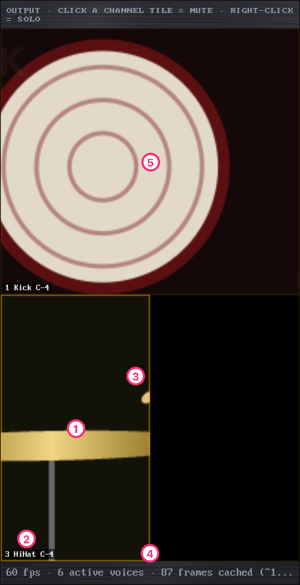

| # | Parça | Ne olduğu |
|---|-------|-----------|
| 1 | Bir kare | Bir kanalın çaldığı. Görüntü, enstrümanın odağı etrafında kareye sığacak şekilde kırpılır. |
| 2 | Etiket | Kanal numarası, enstrüman adı, nota |
| 3 | Vuruş parlaması | Karenin kenarı her vuruşta parlar |
| 4 | İstatistikler | Saniyedeki kare, aktif sesler, önbellekteki kareler, ses gecikmesi ve duyulan pozisyon |
| 5 | Büyümüş bir kare | Kanal 1'de bir `G21` çaldı, bu yüzden karesi çaldığı sürece iki sütun ve bir satır kaplar |

Bir kareye tıklayınca kanalı susar, sağ tıklayınca solo olur.

`Gxy` efekti bir kanalın karesini, kanal çaldığı sürece komşularının üstüne büyütür. Bkz. [Efektler](#efektler).

---

<a id="tezgah"></a>
## Tezgâh (Bench)

Tezgâh (üst bardaki **Bench** ya da **⌘/Ctrl+B**) uzun videolar içindir: bir film, bir canlı kayıt, YouTube'dan
indirilmiş bir video. Videoyu tezgâha koyarsın, bir parça işaretlersin ve onu bir enstrümana kesersin. Kesim videoyu
yeniden encode etmez, bu yüzden hızlıdır ve kaliteyi korur. Kesmediğin her şey atılır: tezgâh hiçbir zaman
kaydedilmez.

MP4, MOV, WebM ve MKV keser. Parça videosunun codec'lerini korur, bu yüzden YouTube'dan bir videoyu H.264 ve AAC
olarak indirmek en iyisi: `yt-dlp -S vcodec:h264,acodec:aac <url>`. yt-dlp'nin varsayılanı (Opus ile AV1 ya da VP9)
PoopTracker'da ve VLC'de çalar, ama ondan yapılan enstrümanları QuickTime açamaz.

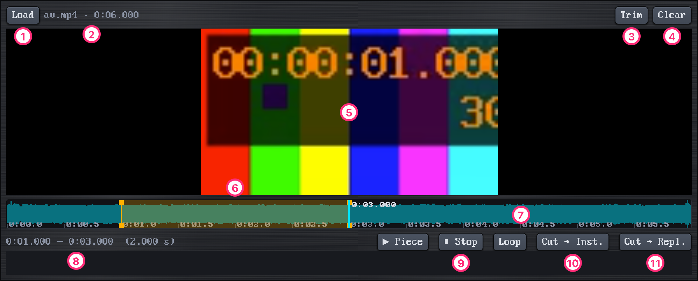

| # | Kontrol | Ne yapar |
|---|---------|----------|
| 1 | **Load** | Tezgâha bir video koyar. Tezgâh açıkken videoyu sayfaya bırakmak da olur. |
| 2 | Ad | Dosya ve uzunluğu |
| 3 | **Trim** | Tezgâhta yalnızca işaretli parçayı bırakır, gerisini atar (Ctrl+Z geri getirir); parça işaretli kalır, hemen kesilebilir. Parça 8 sn'den uzun olabilir. |
| 4 | **Clear** | Videoyu tezgâhtan kaldırır (Ctrl+Z geri koyar) |
| 5 | Görüntü | Keseceğin enstrümanın **odağını** belirlemek için tıkla. Backspace ortaya döndürür. |
| 6 | İşaretli parça | Turuncu şerit. **I** başını, **O** sonunu işaretler, ya da zaman çizelgesinde sürükleyebilirsin. Bir ucu taşımak için tutamağını sürükle. |
| 7 | Zaman çizelgesi | Tıklayınca o noktaya gider. Fare tekerleği ya da iki parmakla yakınlaşır (`=` / `-`, `0` hepsini gösterir). Shift+tekerlek ya da yatay kaydırma boyunca gezer. |
| 8 | Parça | İşaretli parçanın başı, sonu ve uzunluğu (en fazla 8 sn) |
| 9 | **▶ Piece**, **■ Stop**, **Loop** | Parçayı bir kez çalar (Shift+Space); çalarken **▶ Piece** basılı kalır, **■ Stop** durdurur. **Loop** basılıyken durdurana kadar tekrar tekrar çalar; bu sırada uçlarını sürükleyip loop'u bulabilirsin. |
| 10 | **Cut → Inst.** | Parçayı **yeni** bir enstrümana keser (Enter) |
| 11 | **Cut → Repl.** | Parçayı **seçili** enstrümanın videosu yapar, sesini korur (Shift+Enter) |

Kesimden sonra parça enstrüman listesindedir ve vuruşu bulunmuştur. Dalga formunda kontrol et:

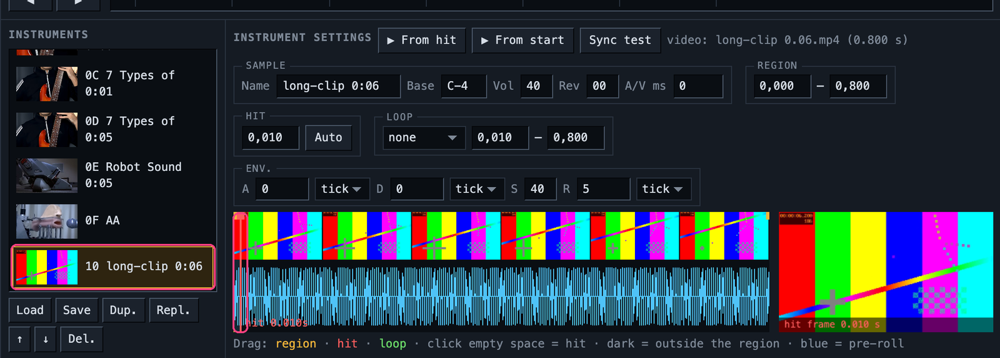

**Tezgâh tuşları:** Space oynat/duraklat · ← → 1 sn · Shift+← → 10 sn · `,` `.` bir kare · Home / End · I / O
işaretle · Shift+Space parçayı çal · Enter kes → yeni · Shift+Enter kes → seçili · Esc işareti kaldır · Backspace
odağı ortaya al.

---

<a id="efektler"></a>
## Efektler

Bir efekt bir harf ve iki hex rakamdır, `xy`. Parametre `00` olursa efekt bir önceki değerini kullanır.

| Efekt | Adı | Ne yapar |
|-------|-----|----------|
| `3xx` | Tone portamento | Önceki notadan bu notaya kayar; `xx` hız |
| `4xy` | Vibrato | `x` hız, `y` derinlik. Görüntü de titrer. |
| `8xx` | Pan | `00` sol, `80` orta, `FF` sağ |
| `9xx` | Sample offset | Bölgenin `xx`/256'sından başlar (pre-roll yok) |
| `Axy` | Ses kaydırma | `x` yukarı, `y` aşağı |
| `E9x` | Retrigger | Her `x` tick'te vuruştan yeniden çalar (kekeleme) |
| `ECx` | Nota kesme | `x`. tick'te susturur |
| `EDx` | Nota geciktirme | Notayı `x` tick geç başlatır |
| `Fxx` | Speed / BPM | `01`–`1F` speed'i, `20`–`FF` BPM'i ayarlar |
| `Sxx` | **Video:** zoom / sarsıntı | Karede bir yumruk etkisi |
| `Ixx` | **Video:** renk ters çevirme | Renkleri ters çeviren bir parlama |
| `Gxy` | **Video:** büyüme | Kare, ızgaranın `x` sütun ve `y` satırını kaplayacak şekilde sağa ve aşağı büyür. `0` bütün genişlik ya da yükseklik demek, yani `G00` bütün ekranı kaplar. `8xx` gibi bir kanal ayarıdır: bir sonraki `G`'ye kadar geçerli kalır (`G11` karenin kendi hücresi), sessizlikten sonraki notalarda da. Bir notanın kendi satırındaysa o notanın pre-roll'undan itibaren geçerlidir. Kanal sustuğu sürece karesi kendi hücresine döner, ki diğerlerini siyahla örtmesin. Altında kalan kareler görünmeden çalmaya devam eder. |

Sadece videoyu etkileyen efektler pattern'de pembe görünür.

---

<a id="dosyalar"></a>
## Dosyalar: şarkılar, enstrüman videoları, MIDI, kayıtlar

### Şarkılar (`.poop`)

**Save** (⌘/Ctrl+S) tek bir `.poop` dosyası yazar. Bu, şarkıyı düz metin olarak (`song.txt`, `patterns/*.txt`) ve
orijinal videoları tutan bir zip'tir ([ZEN-PLAIN-TEXT](ZEN.md)). **Load** (⌘/Ctrl+O) ya da dosyayı sayfaya bırakmak
onu açar. Anlamsız bir dosya reddedilir ve durum çubuğu sorunun nerede olduğunu söyler ([ZEN-EXPLICIT](ZEN.md)).

Chrome ve Edge'de **Save**, şarkıyı açtığın dosyanın üstüne yazar: diyalog da indirme de olmaz (tarayıcı izni bir kere
sorar). Sayfa yenilense de aynı dosyaya yazar. Henüz bir dosyası olmayan şarkıda (Zap'ten sonra, MIDI'den gelen) nereye
kaydedileceği sorulur, o dosya da artık şarkının dosyası olur. Başka bir dosyaya kaydetmek için Shift+tık ya da
⌘/Ctrl+Shift+S. Safari ve Firefox'ta Save, eskisi gibi dosyayı indirir.

### Enstrüman videoları

Enstrüman listesinin altındaki **Save**, enstrümanın videosunu ayarları içinde olacak şekilde yazar (MP4/MOV
metadata'sı). O videoyu herhangi bir PoopTracker'a bırakırsan hazır bir enstrüman olarak gelir. Tek bir sesi
paylaşmanın yolu bu.

### MIDI içe aktarma

Bir `.mid` dosyasını (tip 0 ya da 1) **Load** ile aç ya da sayfaya bırak. Notalar her track için bir enstrüman, her
davul sesi için bir enstrümanla gelir. Her enstrüman sessiz bir "REPLACE ME" videosuyla başlar. Gerçek bir video
vermek için onu seç ve enstrüman listesinin altındaki **Load**'a bas (ya da listede üstüne bir video bırak). Taşınan, sınırlanan ya da atılan
notalar varsa durum çubuğu söyler.

<a id="video-kaydi"></a>
### Video kaydı

**● Rec** şarkıyı baştan çalar ve çıktıyı sesiyle birlikte kaydeder, reverb dahil. Bitirmek için **■ Stop**'a
ya da **Space**'e bas, PoopTracker nereye kaydedeceğini sorar. Tarayıcı yapabiliyorsa dosya MP4, yoksa WebM
olur. Kayıt sürerken başka hiçbir şey çalmayı başlatamaz ve kanal sayısı değişemez.

---

<a id="mcp"></a>
## Bir yapay zekâyla birlikte çalmak (MCP)

Arayüzde bir şarkıya ne yapabiliyorsan, bir yapay zekâ da MCP üzerinden yapabilir ([ZEN-AI-PARITY](ZEN.md)):
şarkıyı okumak, nota yazmak, enstrümanları değiştirmek, video yüklemek, parça kesmek, MIDI içe aktarmak ve
kaydetmek.

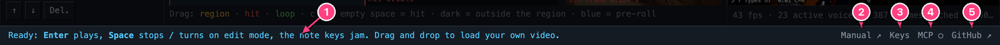

| # | Parça | Ne olduğu |
|---|-------|-----------|
| 1 | Durum | Az önce ne oldu ya da ne ters gitti |
| 2 | **Manual** | Bu kılavuz, GitHub'da (İngilizcesi) |
| 3 | **Keys** | Bütün kısayollar ve efektler, tek bir pencerede |
| 4 | **MCP ●** | Bir yapay zekâ bağlıyken dolu, değilken boş (○) |
| 5 | **GitHub** | Proje sayfası |

MCP için tracker'ın online sürümü değil, kendi bilgisayarında çalışan hali gerekir. Depoyu klonla, klasörünü bir
sunucuyla aç ve Chrome'da http://localhost:8765/ adresine git:

```
python3 -m http.server 8765
```

Sonra Claude Code'u bağla:

```
claude mcp add pooptracker -- node /path/to/pooptracker/mcp/server.mjs
```

Tracker'ı tarayıcıda açık tut. Yapay zekâ bağlanınca ışık **MCP ●** olur. Yapay zekânın yaptığı her değişiklik
anında ekranda görünür ve ⌘/Ctrl+Z ile geri alabilirsin. Başka bir port kullanmak için sunucuyu
`POOPTRACKER_MCP_PORT=8799 node mcp/server.mjs` ile başlat ve tracker'ı `?mcp=8799` ile aç.

Sayfada dolaşan küçük böcek, hata bildirmek için bir link. Bir şey bozuksa ona tıkla.

---

<a id="klavye-ozeti"></a>
## Klavye özeti

Mac'te F tuşları için **fn** gerekir, "F1, F2 vb. tuşları standart işlev tuşları olarak kullan" ayarı açık
değilse. Burada ⌘ ile Ctrl aynı işi görür.

**Çalmak**

| Tuşlar | |
|--------|--|
| Enter | Şarkıyı baştan çal |
| Shift+Enter | Şarkıyı bu pattern'den çal |
| ⌘/Ctrl+Enter | Bu pattern'i döngüde çal |
| Space | Durdur; dururken edit modunu aç/kapat |
| ⌘/Ctrl+F | Follow aç/kapat |
| Shift+M · ⌘/Ctrl+Shift+M · Shift+U | Kanalı sustur · susturmaları ters çevir · hepsini aç |

**Notalar**

| Tuşlar | |
|--------|--|
| Z S X D C V G B H N J M | Notalar, Oct oktavı |
| Q 2 W 3 E R 5 T 6 Y 7 U I 9 O 0 P | Notalar, Oct + 1 oktavı ve üstü |
| 1 / CapsLock | Key-off |
| F1–F8 | Oktav |
| `` ` `` / Shift+`` ` `` | Edit step artır / azalt |
| Shift+↑ / ↓ | Enstrüman |

**Gezinmek, düzenlemek, bloklar:** bkz. [Pattern editörü](#gezinmek).

**Şarkı ve dosyalar**

| Tuşlar | |
|--------|--|
| ⌘/Ctrl+Z · ⌘/Ctrl+Shift+Z | Geri al · yeniden yap |
| ⌘/Ctrl+S · ⌘/Ctrl+O | Şarkıyı kaydet · şarkı aç |
| ⌘/Ctrl+B | Pattern ⇄ Bench |
| ⌘/Ctrl+F9 / F10 | Order pozisyonu sil / ekle |

**Tezgâh:** bkz. [Tezgâh](#tezgah).
